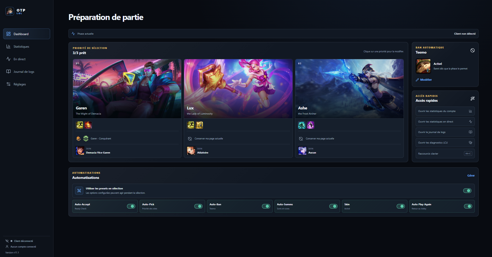
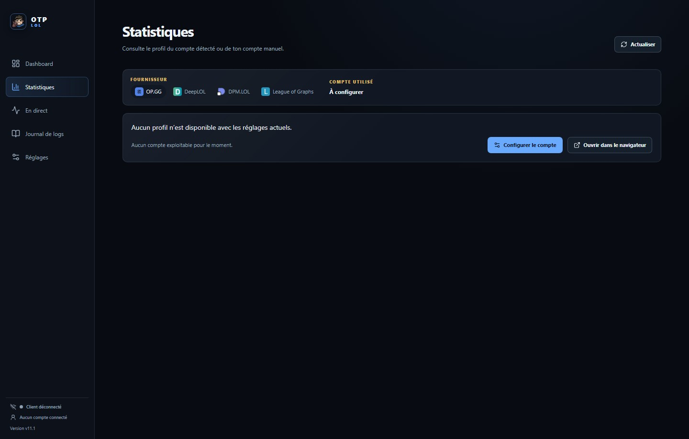
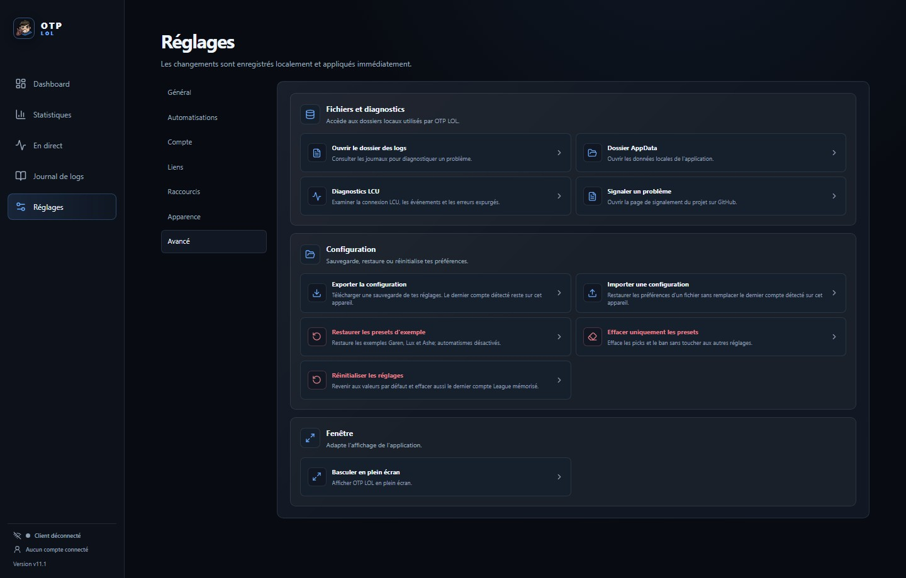
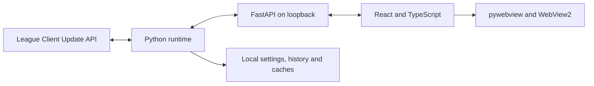

<p align="center">
  
</p>

<h1 align="center">OTP LOL</h1>

<p align="center"><strong>A local Windows companion for the repeatable steps around a League of Legends match.</strong></p>

<p align="center">
  <a href="https://github.com/qurnt1/otp_lol/releases"></a>
  <a href="https://github.com/qurnt1/otp_lol"></a>
  
  
</p>

OTP LOL connects to the League Client Update API on your PC. You set champion priorities and loadouts once; the app can apply the client actions you enable while you queue and enter champion select. You stay in control of each automation, and OTP LOL does not play the match or choose your strategy.

[Download the latest Windows release](https://github.com/qurnt1/otp_lol/releases) · [See the screenshots](#screenshots) · [Run from source](#run-from-source)

## Screenshots

<p align="center">
  
</p>

<table>
  <tr>
    <td width="50%"></td>
    <td width="50%"></td>
  </tr>
</table>

These are product UI captures from the browser E2E environment. League is simulated or disconnected; the screenshots do not show a live match or a real player account. The Statistics page shows provider selection, not statistics hosted by OTP LOL.

## What it does

- **Prepare champion select:** keep three pick priorities and a ban, then configure summoner spells, rune pages and fixed or random skins for each pick.
- **Automate the client steps you choose:** ready-check acceptance, priority picks, bans, spells and runes, skin selection, and returning to the lobby after a game.
- **Keep settings visible and adjustable:** use the dashboard, role filters in the champion picker, keyboard shortcuts, and the system tray controls.
- **Open player pages when useful:** choose a statistics or live-game provider. Each page opens in its own desktop WebView when available, with the system browser as fallback.
- **Keep working when League is closed:** edit presets and settings while disconnected. Live client actions wait until the League client is available.

The Statistics and Live pages select third-party providers. They are not an in-app match-history or live-game analytics service. The chosen provider receives the profile URL when you open its page.

## Installation

1. Download the latest available Windows installer from [GitHub Releases](https://github.com/qurnt1/otp_lol/releases).
2. Install the [Microsoft Edge WebView2 Evergreen Runtime](https://developer.microsoft.com/microsoft-edge/webview2/) if it is not already present.
3. Open the League client, then start OTP LOL.
4. Review the example presets and enable only the automations you want.

OTP LOL requires Windows, the League client on the same PC, and WebView2. Example presets are editable and automation switches are off by default on first launch.

## Run from source

From the repository root in PowerShell:

```powershell
python -m venv .venv
.\.venv\Scripts\Activate.ps1
python -m pip install -c requirements-constraints.txt -r requirements.txt

Push-Location frontend
npm ci
npm run build
Pop-Location

python launcher_web.py
```

The desktop launcher serves the compiled React app from `frontend/dist` in a pywebview window and starts the local FastAPI API. Build the frontend before launching; the app does not use the Vite development server as its desktop runtime.

## How it is put together



- `src/lcu/` owns the local League client connection, runtime state, static-data snapshots and automation.
- `src/api/` exposes validated HTTP and WebSocket boundaries through FastAPI and Pydantic schemas.
- `frontend/src/` is the React/TypeScript desktop interface. Its API types are generated from OpenAPI.
- `src/desktop/` owns the pywebview shell, window lifecycle, tray and native shortcuts.
- `website/` is the separate public marketing site; it is not the desktop interface.

Settings, history and caches live on the PC under `%APPDATA%\OTP LOL`. The API binds to loopback. Public game assets and update information may be requested from their providers; there is no OTP LOL account or hosted user profile.

## Development checks

The project development guide contains the full setup, quality checks, E2E commands and Windows packaging smoke steps: [docs/development.md](./docs/development.md).

The main browser and API E2E paths run a real local FastAPI process with a controllable fake League client. They cover the app boundary without connecting to a user's League account. A packaged desktop smoke still requires Windows and WebView2.

## Privacy and compatibility

- OTP LOL stores its settings and local history on your PC; it does not require an OTP LOL login or cloud dashboard.
- The app communicates with the League client on the same machine and may retrieve public game assets or release information.
- Opening a player-stat page sends the selected provider the profile URL.
- OTP LOL is an independent community project. It is not affiliated with or endorsed by Riot Games. League of Legends and related marks belong to Riot Games.

## Project documents

- [Development and packaging guide](./docs/development.md)
- [Architecture](./docs/architecture.md)
- [Security model](./docs/security.md)
- [Release notes](./track_updates.md)
- [Project presentation source (LaTeX)](./otp-lol-case-study.tex)
